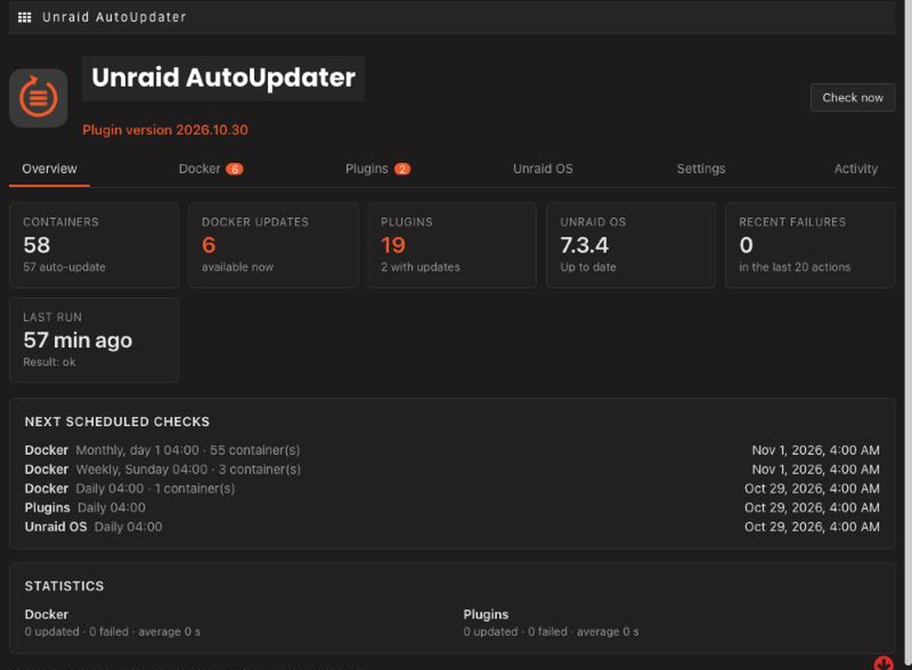

<p align="center"></p>

# Unraid Swiss Manager

<p align="center">


</p>

Keep your Unraid server up to date from one dashboard: Docker containers, plugins and Unraid OS, with schedules, safety checks, history and Discord notifications. It only uses Unraid's own update mechanisms and never bypasses its checks.

## Features

- **Docker containers** – global default plus a per-container policy (*Auto update*, *Notify only*, *Ignore*), schedule (daily, weekly, bi-weekly, monthly), delay, maintenance window and optional backup. Updates are verified; the old image is only removed after success.
- **Plugins** – update checks, notifications and optional automatic installation, per plugin, with safety validation.
- **Unraid OS** – checked and **notify only by default**. Automatic install and reboot are opt-in, with a maintenance window, a waiting period and a pre-update workflow (plugins first, health checks, optional confirmation).
- **Discord** – optional webhook notifications with the Unraid Swiss Manager logo.
- **History and dashboard** – dark UI that matches Unraid, an activity log and statistics.



## ⚠️ Disclaimer

This plugin was written by me with the help of AI assistants (Claude and ChatGPT). It has had only limited testing and is provided **"as is", without warranty of any kind**. It can update Docker containers and plugins and, if you enable it, install Unraid OS updates and reboot your server.

**Use it at your own risk.** I accept no responsibility or liability for data loss, downtime, or any other damage resulting from its use. Before installing, back up your flash drive and important data, and review the settings before turning on any automatic action.

## Install and update

1. In Unraid open **Plugins → Install Plugin** and paste:

   ```
   https://raw.githubusercontent.com/Stiphr/Unraid-Swiss-Manager/refs/heads/stable/unraid-autoupdater.plg
   ```
2. Open it from **Settings → User Utilities → Unraid Swiss Manager** (or click its icon on the Plugins page).
3. **Updates** appear on the Plugins page like for any other plugin.

Coming from *Docker Auto Update* (`docker.autoupdate`)? Just update it from the Plugins page. Your settings, history and webhook are kept and the old entry is removed.

By default nothing is changed automatically: Docker auto-updates are off until a container is set to *Auto update*, and OS updates are notify-only.

## More information

- [Detailed guide](docs/USAGE.md) – defaults, policies, Docker and OS update steps, backups, Discord, scheduling, data, limitations, troubleshooting, removal
- [Architecture](docs/ARCHITECTURE.md)
- [Changelog](CHANGES.txt)

## Development

```
python3 build.py 2026.10.30a  # builds the .plg files from src/
php tests/run.php             # all tests, fully mocked
```
